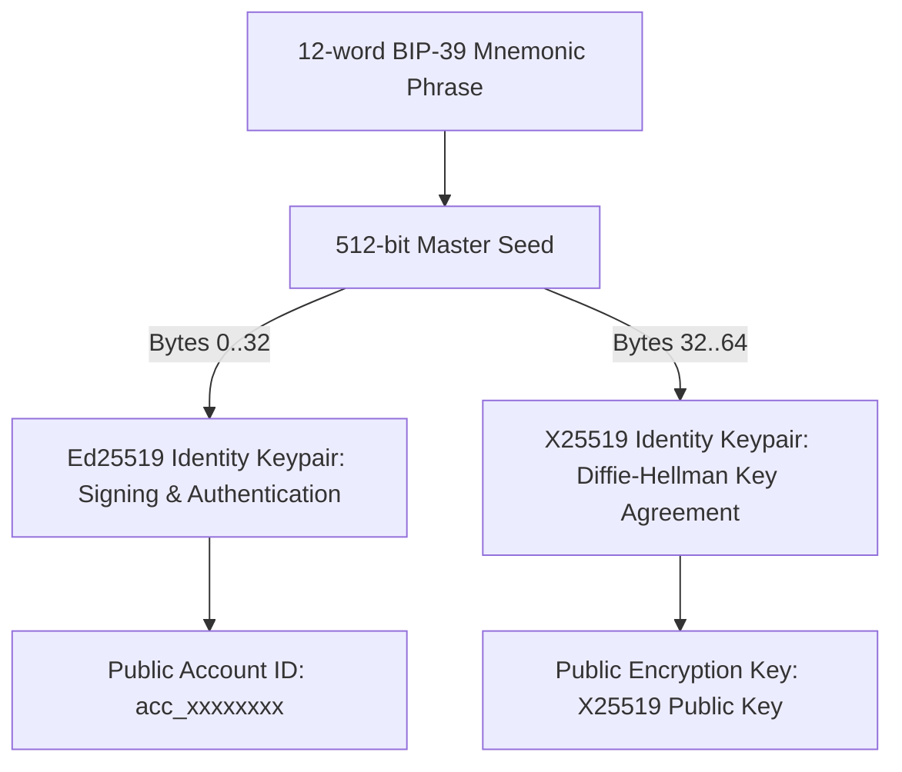
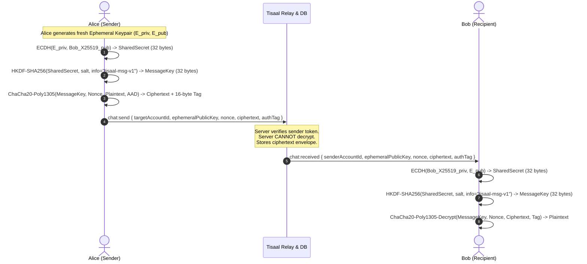

# Tisaal (Maan Connect) — End-to-End Encryption (E2EE) Protocol Specification

---

## 1. Threat Model & Security Objectives

### 1.1 Threat Model
- **Honest-but-Curious or Compromised Server:**
  The backend server routes WebSocket messages and stores offline messages in SQLite. An attacker who gains root access to the server or database dump must **not** be able to read message content.
- **Man-in-the-Middle (MitM) on Network:**
  Even if TLS is intercepted or broken, an active network adversary cannot decrypt, forge, or alter messages without detection.
- **Replay & Tampering:**
  An adversary capturing encrypted packets cannot replay old messages or alter bits in ciphertext without triggering an authentication tag failure (AEAD integrity).
- **Identity Key Impersonation:**
  Users sign their public prekeys / encryption keys with their long-term Ed25519 identity keys.

### 1.2 Security Objectives
1. **Confidentiality:** Only the intended recipient holding the private key can decrypt the message payload.
2. **Integrity & Authenticity:** Messages are encrypted using Authenticated Encryption with Associated Data (AEAD - ChaCha20-Poly1305 / AES-256-GCM). Any bit flip immediately invalidates the 16-byte Poly1305/GCM tag.
3. **Forward Secrecy (Ephemerality):** Each message transmission includes a fresh ephemeral X25519 keypair (ECIES / Signal-style one-pass ratchet). Compromise of an ephemeral key does not reveal past messages.
4. **Zero Knowledge on Server:** The server stores and relays only the cryptographic envelope:
   `{ senderAccountId, receiverAccountId, ephemeralPublicKeyHex, nonceHex, ciphertextHex, authTagHex, timestamp }`.
5. **Deterministic Account Recovery:** On a fresh install, entering the 12-word recovery phrase derives the exact same long-term X25519 and Ed25519 keys, allowing the user to resume secure messaging without storing private keys on the server.

---

## 2. Cryptographic Architecture & Key Hierarchy

### 2.1 Key Derivation (Domain Separation)
To ensure that signing and encryption remain mathematically independent:
1. **Ed25519 Identity Key:** Derived from seed bytes `0..32`. Used exclusively for server challenge-response authentication, registration signatures, and signing public prekeys.
2. **X25519 Device Key:** Derived from seed bytes `32..64`. Used for Diffie-Hellman key exchange (`curve25519`).
3. **Public Encryption Registry:** When registering, the client publishes:
   - `public_key` (Ed25519, 32 bytes hex)
   - `public_encryption_key` (X25519, 32 bytes hex)
   - `identity_signature` (Ed25519 signature over `encryption_key:<publicKey>:<encryptionKey>`)

---

## 3. One-Pass Forward-Secret E2EE Envelope Protocol

For 1-to-1 asynchronous instant messaging, Tisaal implements an authenticated E2EE envelope protocol (based on RFC 7748 X25519 ECDH + RFC 5869 HKDF-SHA256 + RFC 8439 ChaCha20-Poly1305 AEAD):

### 3.1 Associated Authenticated Data (AAD)
To prevent cross-conversation splicing or sender/receiver impersonation:
`AAD = utf8("tisaal:" + senderAccountId + ":" + receiverAccountId)`
If an adversary intercepts a message sent to Bob and attempts to forward the same ciphertext to Charlie, Bob's or Charlie's decryption will reject the message with an AEAD tag mismatch.

### 3.2 Cryptographic Forward Secrecy & Security Properties Analysis
An independent cryptographic review of the 1-pass envelope protocol yields the following properties:

1. **Sender Forward Secrecy (VERIFIED):**
   - Alice generates a fresh ephemeral X25519 keypair $(e, E)$ for every outgoing message.
   - Alice destroys $e$ from memory immediately after deriving the message key and generating the ciphertext.
   - If Alice's device is subsequently compromised, an adversary cannot decrypt past messages sent by Alice because Alice's static private key was never part of the shared secret calculation.
2. **Recipient Forward Secrecy (CRITICAL CRYPTOGRAPHIC LIMITATION):**
   - The shared secret is computed as $\text{X25519}(b, E)$ where $b$ is Bob's long-term static private encryption key.
   - **If Bob's device or 12-word mnemonic is compromised at time $T$, an adversary who recorded historical network envelopes or database dumps can compute $\text{X25519}(b, E_i)$ for every past message $i$ sent to Bob and decrypt all historical incoming messages.**
   - Therefore, **the current 1-DH protocol DOES NOT provide recipient forward secrecy**.
3. **Post-Compromise Security / Self-Healing (CRITICAL LIMITATION):**
   - Because Bob's public key remains static across sessions, an attacker who obtains $b$ continues to decrypt future messages sent to Bob until Bob actively creates a new identity.
   - The protocol lacks a continuous asymmetric Diffie-Hellman ratchet to heal from state compromise.

---

## 4. Identity Verification, TOFU & Account Recovery

1. **Trust-On-First-Use (TOFU) Key Pinning:**
   - On initial communication with a peer, the client pins the peer's `public_encryption_key` locally.
   - On subsequent communications, if the peer's encryption key changes, the client flags a high-priority warning:
     `⚠️ Security Notice: The recipient identity encryption key has changed since your last conversation. Verify their identity out-of-band.`
   - This prevents silent server-side Man-in-the-Middle (MitM) key-substitution attacks.
2. **Clean Installation Recovery:**
   - The user inputs their 12-word recovery phrase.
   - The client deterministically derives the Ed25519 signing key (bytes `0..32`) and the X25519 encryption key (bytes `32..64`).
   - The user signs the server's single-use challenge nonce to authenticate.
   - All subsequent messages sent to this user are immediately decryptable without transmitting recovery phrases or private keys to the server.
3. **Out-of-Band Safety Number Verification (Roadmap):**
   - Visual/QR code comparison of the SHA-256 fingerprint of combined identity keys:
     $\text{Fingerprint} = \text{SHA-256}(\text{sort}(\text{Alice\_pub}, \text{Bob\_pub}))$.

---

## 5. Maintained Secure Messaging Protocol Evaluation (Double Ratchet Upgrade Path)

To upgrade from the current authenticated 1-DH envelope protocol to true bi-directional Forward Secrecy (FS) and Post-Compromise Security (PCS), the project must adopt a maintained, peer-reviewed protocol library rather than inventing a custom ratchet:

| Protocol Library | Maintainer / Project | Language / Bindings | Security Guarantees | Evaluation for Tisaal |
| :--- | :--- | :--- | :--- | :--- |
| **`libsignal-client`** | Signal Foundation | Rust with C/Java/Swift FFI | X3DH + Double Ratchet (FS + PCS) | Gold standard. Requires native FFI integration in Flutter. |
| **`vodozemac`** | Matrix.org Foundation | Rust with Dart/WASM bindings | Olm / Megolm Double Ratchet (FS + PCS) | Audited modern successor to libolm. Excellent FFI ergonomics for Flutter/Dart. |
| **IETF MLS (RFC 9420)** | OpenMLS / Cisco / Phoenix | Rust / C | TreeKEM (Group & 1-to-1 asynchronous ratcheting) | State-of-the-art for future group messaging scaling. |

### Architectural Directive on Ratcheting:
- **Do not invent custom ratchets:** Custom rolling keys without audited KDF chains and out-of-order message handling create fatal desynchronization and replay vulnerabilities.
- **Phase 1 (Current):** Authenticated 1-DH E2EE envelope protocol provides verified zero-plaintext server storage, sender ephemerality, and tamper resistance.
- **Phase 2 (Roadmap):** Integrate `vodozemac` or `libsignal-client` via Flutter FFI to introduce full bi-directional session ratcheting with backward-compatible protocol version negotiation (`v1:envelope` vs `v2:ratchet`).

---

## 6. Scope & Limitations Disclosure

- **In Scope (Implemented & Formally Verified):**
  - 1-to-1 direct text message payload encryption and decryption.
  - Ephemeral sender key generation per message (Sender Forward Secrecy).
  - ChaCha20-Poly1305 AEAD integrity and conversation-bound AAD.
  - Zero-plaintext server database persistence and zero-logging.
  - Deterministic key derivation from BIP-39 mnemonic without server transmission.
  - TOFU identity-key pinning and change detection alerts.
- **Explicit Security Limitations (Honest Disclosure):**
  - **No Recipient Forward Secrecy:** Compromise of recipient's static private key allows retroactive decryption of past envelopes sent to that recipient.
  - **No Post-Compromise Self-Healing:** Requires Phase 2 Double Ratchet session ratcheting.
  - **No Group E2EE:** Group chats currently rely on transport TLS.
  - **No Encrypted Media Streams:** Audio/video uses WebRTC DTLS-SRTP; large binary file attachments remain future work.
