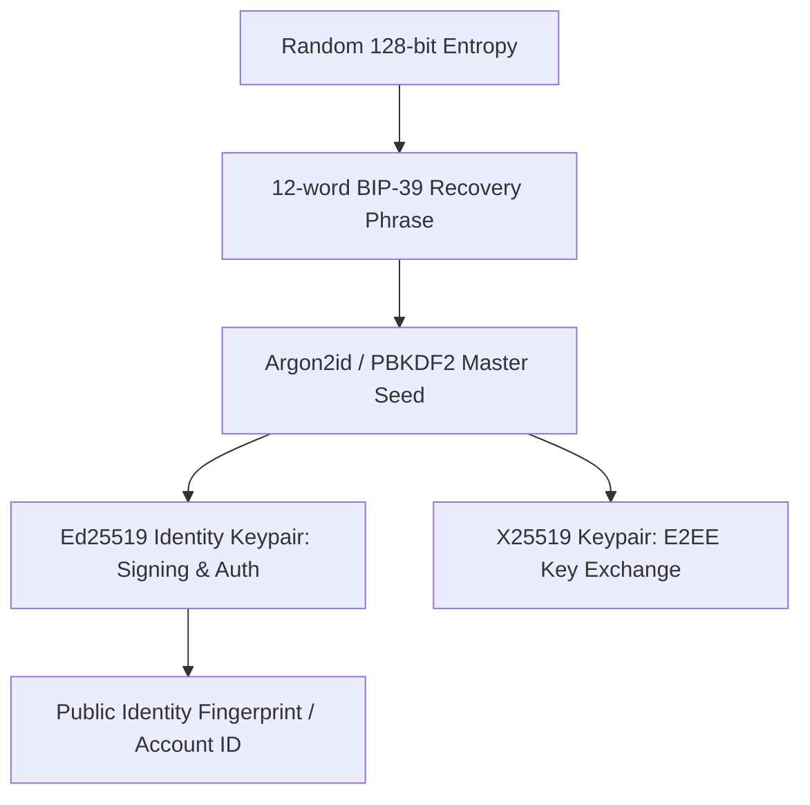
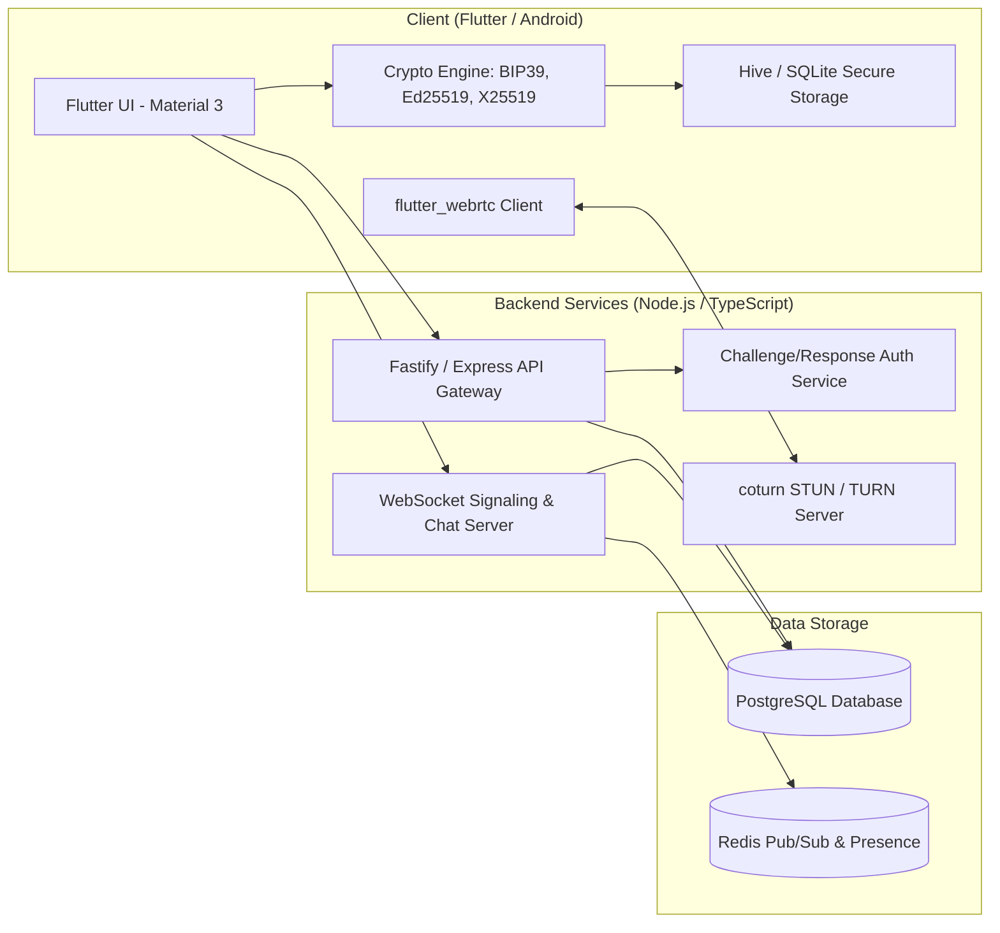

# Maan Connect / Tisaal (اتصال)
## Phone-Number-Free Global Communication Platform — MVP Technical Specification

---

## 1. Executive Summary & Vision (خلاصہ اور وژن)
**Maan Connect (Tisaal)** ایک نجی اور خود مختار عالمی مواصلاتی پلیٹ فارم ہے جس میں صارف کو اکاؤنٹ بنانے کے لیے کسی **موبائل فون نمبر**، **ای میل ایڈریس** یا **SIM کارڈ** کی ضرورت نہیں ہوتی۔
ہر صارف کی شناخت اس کی منفرد **Cryptographic Identity** اور اس کے منتخب کردہ یا خودکار تخلیق شدہ **Username / User ID** پر منحصر ہوتی ہے۔

### بنیادی اصول (Core Pillars):
1. **Zero Personal Identifiable Information (Zero PII):** کوئی فون نمبر، ای میل، یا سم کارڈ ڈیٹا درکار نہیں۔
2. **Cryptographic Identity & Recovery:** ہر اکاؤنٹ ایک 12 یا 24 الفاظ کے Mnemonic Phrase (BIP-39) / Ed25519 Keypair کے ساتھ جڑا ہوتا ہے۔
3. **Decoupled Username & Account ID:** صارف اپنا پبلک ہینڈل (`@username`) تبدیل کر سکتا ہے جبکہ اس کی اصل کرپٹوگرافک `Account ID` مستقل رہتی ہے۔
4. **End-to-End Ready Architecture:** پیغامات اور کال سگنلنگ کو جدید E2EE (X3DH / Double Ratchet ماڈل) کے مطابق ڈیزائن کیا گیا ہے۔
5. **Direct P2P Calling with WebRTC:** آڈیو اور ویڈیو کالز براہ راست P2P منتقل ہوتی ہیں، جس سے سرور بینڈوڈتھ اور لاگت کم سے کم رہتی ہے۔

---

## 2. Cryptographic Identity & Recovery System (شناخت اور سکیورٹی میکانزم)

### 2.1 کلیدی جوڑے اور شناخت کی ساخت (Key Architecture)


1. **Entropy & Mnemonic:** اکاؤنٹ بناتے وقت ڈیوائس پر کرپٹوگرافک محفوظ رینڈم جنریٹر (CSPRNG) سے 128-bit اینٹروپی تیار ہوگی جو 12 الفاظ کی انگریزی/عربی فقرہ (Seed Phrase) بنے گی۔
2. **Master Key Derivation:**
   - **Identity Key (Ed25519):** سرور پر تصدیق اور پیغامات پر دستخط کرنے کے لیے۔
   - **Prekey / Curve25519 (X25519):** End-to-End Encryption اور خفیہ کلیدوں کے تبادلے کے لیے۔
3. **Account ID:** Identity Public Key کا ایک چھوٹا، محفوظ ہیش (SHA-256 مختصر شکل جیسے `acc_8f9c1a...`) مستقل شناخت کے طور پر کام کرے گا۔
4. **Public Handle (Username):** صارف کی مرضی کا `@usman786` یا خودکار جنریٹڈ جیسے `@MC-7K4P92`۔ یہ منفرد ہوگا اور سرور کی رجسٹری میں اکاؤنٹ ID کے ساتھ میپ ہوگا۔

### 2.2 ریکوری اور نیا لاگ ان فلو (Recovery Flow)
1. نئے فون پر صارف 12 الفاظ کا فقرہ داخل کرتا ہے۔
2. لوکل ڈیوائس پر Ed25519 Identity Key دوبارہ حساب (derive) ہوتی ہے۔
3. سرور صارف کو ایک سائن کرنے کا چیلنج (Random Nonce) بھیجتا ہے۔
4. ایپ اپنی Identity Private Key سے Nonce پر دستخط کر کے سرور کو بھیجتی ہے۔
5. سرور پبلک کی سے تصدیق کر کے ایک JWT / Session Token جاری کرتا ہے۔ **سرور کو صارف کا ریکوری فقرہ کبھی نہیں ملتا۔**

---

## 3. سسٹم آرکیٹیکچر (System Architecture)



---

## 4. ڈیٹا بیس اسکیما (PostgreSQL Schema)

```sql
-- 1. Users & Public Handles
CREATE TABLE users (
    id UUID PRIMARY KEY DEFAULT gen_random_uuid(),
    account_id VARCHAR(64) UNIQUE NOT NULL, -- Hash of Ed25519 Public Key
    public_identity_key TEXT NOT NULL,       -- Hex/Base64 Ed25519 Public Key
    username VARCHAR(32) UNIQUE NOT NULL,    -- e.g. 'usman786' or 'MC-7K4P92'
    display_name VARCHAR(64),
    avatar_url TEXT,
    bio VARCHAR(256),
    created_at TIMESTAMP WITH TIME ZONE DEFAULT NOW(),
    updated_at TIMESTAMP WITH TIME ZONE DEFAULT NOW()
);

-- 2. Devices & Public Prekeys (E2EE Support)
CREATE TABLE user_devices (
    id UUID PRIMARY KEY DEFAULT gen_random_uuid(),
    user_id UUID REFERENCES users(id) ON DELETE CASCADE,
    device_id VARCHAR(64) NOT NULL,
    device_name VARCHAR(100),
    fcm_token TEXT,
    public_prekey TEXT,                     -- X25519 Public Prekey for E2EE
    last_active TIMESTAMP WITH TIME ZONE DEFAULT NOW(),
    UNIQUE(user_id, device_id)
);

-- 3. Contact Connections & Requests
CREATE TYPE connection_status AS ENUM ('pending', 'accepted', 'blocked');

CREATE TABLE contacts (
    id UUID PRIMARY KEY DEFAULT gen_random_uuid(),
    sender_id UUID REFERENCES users(id) ON DELETE CASCADE,
    receiver_id UUID REFERENCES users(id) ON DELETE CASCADE,
    status connection_status DEFAULT 'pending',
    created_at TIMESTAMP WITH TIME ZONE DEFAULT NOW(),
    updated_at TIMESTAMP WITH TIME ZONE DEFAULT NOW(),
    UNIQUE(sender_id, receiver_id)
);

-- 4. Conversations & Messages
CREATE TABLE conversations (
    id UUID PRIMARY KEY DEFAULT gen_random_uuid(),
    is_group BOOLEAN DEFAULT FALSE,
    created_at TIMESTAMP WITH TIME ZONE DEFAULT NOW()
);

CREATE TABLE conversation_participants (
    conversation_id UUID REFERENCES conversations(id) ON DELETE CASCADE,
    user_id UUID REFERENCES users(id) ON DELETE CASCADE,
    joined_at TIMESTAMP WITH TIME ZONE DEFAULT NOW(),
    PRIMARY KEY (conversation_id, user_id)
);

CREATE TYPE message_type AS ENUM ('text', 'image', 'audio', 'call_log');

CREATE TABLE messages (
    id UUID PRIMARY KEY DEFAULT gen_random_uuid(),
    conversation_id UUID REFERENCES conversations(id) ON DELETE CASCADE,
    sender_id UUID REFERENCES users(id) ON DELETE SET NULL,
    content_encrypted TEXT NOT NULL,         -- Ciphertext (E2EE)
    message_type message_type DEFAULT 'text',
    metadata JSONB DEFAULT '{}',
    is_delivered BOOLEAN DEFAULT FALSE,
    is_read BOOLEAN DEFAULT FALSE,
    created_at TIMESTAMP WITH TIME ZONE DEFAULT NOW()
);

-- 5. Call Sessions (For signaling and audit logs)
CREATE TYPE call_status AS ENUM ('ringing', 'connected', 'ended', 'missed', 'rejected');
CREATE TYPE call_type AS ENUM ('audio', 'video');

CREATE TABLE call_logs (
    id UUID PRIMARY KEY DEFAULT gen_random_uuid(),
    caller_id UUID REFERENCES users(id) ON DELETE SET NULL,
    callee_id UUID REFERENCES users(id) ON DELETE SET NULL,
    type call_type DEFAULT 'audio',
    status call_status DEFAULT 'ringing',
    duration_seconds INT DEFAULT 0,
    started_at TIMESTAMP WITH TIME ZONE DEFAULT NOW(),
    ended_at TIMESTAMP WITH TIME ZONE
);
```

---

## 5. WebRTC اور رئیل ٹائم سگنلنگ فلو (Call & Real-time Flow)

```mermaid
sequenceDiagram
    autonumber
    actor Caller as User A (Caller)
    participant WS as WebSocket Server
    actor Callee as User B (Callee)

    Caller->>WS: call:initiate { targetUserId, callType: "video" }
    WS->>Callee: call:incoming { callerId, callerUsername, callType }
    
    alt Callee Accepts
        Callee->>WS: call:accept { callerId }
        WS->>Caller: call:accepted
        Caller->>Callee: WebRTC Offer (SDP) via WS
        Callee->>Caller: WebRTC Answer (SDP) via WS
        Caller<->Callee: ICE Candidates Exchange via WS
        Note over Caller, Callee: P2P Direct Media Stream Established (Audio/Video)
    else Callee Rejects
        Callee->>WS: call:reject { callerId, reason: "busy" }
        WS->>Caller: call:rejected { reason: "busy" }
    end
```

### STUN / TURN حکمت عملی:
1. **Google Public STUN:** مفت کنکشنز کے لیے (`stun:stun.l.google.com:19302`) ابتدائی ٹیسٹنگ میں استعمال ہوگا۔
2. **CoTURN (Self-hosted) یا Twilio / Cloudflare Calls:** جب دونوں ڈیوائسز سخت Symmetric NAT کے پیچھے ہوں تو TURN ریلے سرور بیک اپ کے طور پر استعمال ہوگا۔

---

## 6. اسکرینز اور UI/UX فلو (Mobile App Screens)

1. **اسکرین 1: Identity Creation (خوش آمدید اور شناخت کا انتخاب)**
   - سلیکٹ کریں: Auto-generate ID (مثلاً `@MC-7K4P92`) یا اپنی مرضی کا Handle چیک کریں۔
   - بغیر کسی سم، نمبر یا ای میل کے سنگل کلک کریئشن۔
2. **اسکرین 2: Recovery Phrase Backup (ریکوری فقرہ)**
   - 12 الفاظ کا گرڈ واضح ڈیزائن اور کاپی/محفوظ کرنے کی ہدایت کے ساتھ۔
   - صارف کی تصدیق (ایک یا دو الفاظ کو منتخب کر کے تصدیق کہ اس نے لکھ لیا ہے)۔
3. **اسکرین 3: Main Navigation & Chats (چیٹ لسٹ اور سرچ)**
   - سرچ بار: کسی بھی صارف کو اس کے `@username` سے تلاش کر کے ریکویسٹ بھیجنا۔
   - آن لائن اسٹیٹس بیج، آخری میسج اور ٹائم اسٹیمپ۔
   - نیویگیشن بار: Chats, Calls, Contacts, Settings.
4. **اسکرین 4: Active Chat Screen (گفتگو کی اسکرین)**
   - ٹیکسٹ میسج ان پٹ، آڈیو وائس نوٹ، اور اٹیچمنٹ۔
   - اوپر دائیں جانب: وائس کال اور ویڈیو کال کے بٹنز۔
5. **اسکرین 5: Voice & Video Call Screen (کالنگ اسکرین)**
   - آنے والی کال کے لیے خوبصورت فل اسکرین ڈائلر (قبول / مسترد)۔
   - لائیو ویڈیو فیڈ (پکچر ان پکچر لوکل کیمرہ، ریموٹ فل اسکرین)۔
   - مائیک میوٹ، کیمرہ فلپ، اسپیکر اور کال اینڈ بٹن۔
6. **اسکرین 6: Settings & Security (سیٹنگز اور پرائیویسی)**
   - اپنا `@username` اور `Account ID` کاپی کرنا۔
   - View / Export Recovery Phrase (بایومیٹرک یا پن کے بعد)۔
   - Privacy Controls (کون تلاش کر سکتا ہے، کون کال کر سکتا ہے)۔

---

## 7. فیز وار ترقیاتی منصوبہ (Development Phases)

| مرحلہ | تفصیلات | مدت / حیثیت |
| :--- | :--- | :--- |
| **مرحلہ 1: Foundations** | Node.js Backend API + WebSocket سگنلنگ سرور + Flutter پروجیکٹ کا ڈھانچہ | تیار کرنے کے لیے منتخب کریں |
| **مرحلہ 2: Identity & Crypto** | 12-Word Mnemonic، Ed25519 سائننگ، ریکوری فلو، گیسٹ/آٹو جنریٹ لاگ ان | مرحلہ 1 کے فوراً بعد |
| **مرحلہ 3: Messaging & WS** | رئیل ٹائم چیٹ، کانٹیکٹ سرچ، ریکویسٹ سسٹم، میسج ہسٹری | مرحلہ 2 کے بعد |
| **مرحلہ 4: WebRTC Calling** | 1-to-1 آڈیو اور ویڈیو کالز، کال اسکرین، سگنلنگ اور STUN ٹیسٹنگ | مرحلہ 3 کے بعد |
| **مرحلہ 5: Polish & Security** | ہارڈننگ، ریٹ لمٹس، نوٹیفیکیشنز، اینڈرائیڈ APK بلڈ | آخری مرحلہ |
